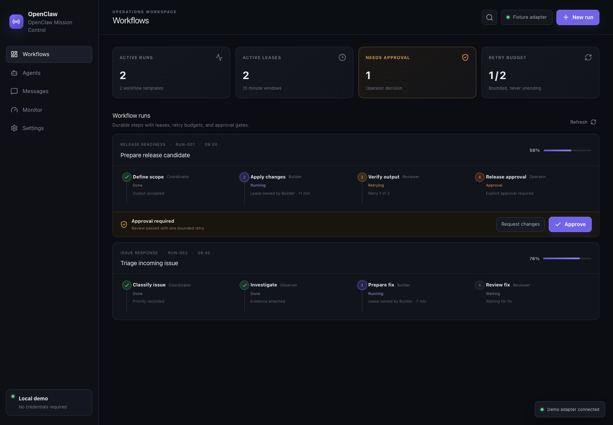
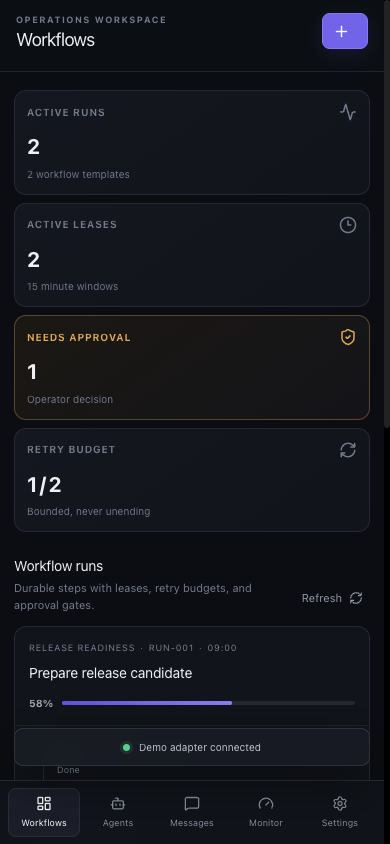

# OpenClaw Mission Control

OpenClaw Mission Control is a runnable demo of an agent-workflow control interface. It visualizes leases, bounded retries, approval gates, audit events, monitoring, and agent messages using deterministic local state.

This public edition does **not** operate a live OpenClaw deployment. It never contacts Convex or OpenClaw, operational APIs return `403`, and demo state resets on refresh. The retained integration code is included for architecture review and is disabled by design.

## Features

- Multi-step workflow runs with explicit ownership and lease expiry
- Bounded retry budgets and operator approval gates
- Append-only workflow activity and attributable audit events
- Agent directory, direct messaging, runtime monitoring, and local settings
- Deterministic, browser-memory demo with no external services or credentials
- Secure-by-default API, session, file, webhook, and process-control boundaries
- Responsive desktop and mobile interface

## Architecture

```text
Browser
  └─ Demo adapter (deterministic in-memory fixtures)
```

The public release is intentionally demo-only and never contacts Convex or OpenClaw. Operational API routes return `403`, including in production, and environment variables cannot reactivate the retained live implementation. The retained Convex functions also require a Convex authentication identity as defense in depth. See [docs/ARCHITECTURE.md](docs/ARCHITECTURE.md) for details.

## Setup

Requirements: Node.js 22+ and pnpm 11+.

```bash
git clone <repository-url>
cd openclaw-mission-control
corepack enable
pnpm install --frozen-lockfile
cp .env.example .env.local
pnpm dev
```

Open `http://localhost:3000`. The example environment enables demo mode and contains placeholders only.

### Demo mode

```bash
DEMO_MODE=true pnpm dev
```

The demo supports creating workflow runs, requesting or granting approval, consuming a bounded retry, sending an agent message, simulating a stream reconnect, viewing audit events, and changing a local setting. State is intentionally reset on refresh.

### Live mode

Live mode is not shipped as a supported runtime in this release. Do not deploy the retained Convex sources as an application backend without adding and testing a complete Convex auth provider, authenticated server adapter, and data migration. Workspace code has no home-directory fallback and requires an explicit `OPENCLAW_WORKSPACE_ROOT` before it can resolve a path.

## Commands

```bash
pnpm dev
pnpm test:run
pnpm typecheck
pnpm build
pnpm lint
```

## Screenshots

These screenshots were captured from the deterministic demo using a real production build. They contain only the neutral fixtures included in this repository.

### Desktop



### Mobile



## Security

This release fails closed as a demo-only artifact: operational API routes are disabled in development and production, direct Convex access requires an authenticated identity, and no environment flag enables live mode. Retained file access code requires one explicitly configured root, rejects traversal and symlinks, and denies common secret-bearing files. System controls use a fixed target/action allowlist and spawn fixed executables without a shell.

Read [SECURITY.md](SECURITY.md) and [docs/THREAT_MODEL.md](docs/THREAT_MODEL.md) before modifying any retained integration code. Keep the demo on loopback or behind a trusted authenticated reverse proxy; it is not designed for direct exposure to the public internet.

## Roadmap

- Persist demo scenarios as importable, versioned fixture packs
- Add browser-tested accessibility and reconnect regression coverage in CI
- Expand workflow visualization for branches and parallel steps
- Add documented adapters for more durable stores without weakening local defaults
- Expand the sanitized visual regression suite beyond the primary workflow view

## Provenance and attribution

This is a sanitized public edition of a privately developed project, not the production deployment. See [PROVENANCE.md](PROVENANCE.md) for the export boundary.

This project is based in part on `manish-raana/openclaw-mission-control` under Apache-2.0 and has been substantially modified. The inherited favicon was replaced with an original asset. See [NOTICE.md](NOTICE.md) and [LICENSES/Apache-2.0.txt](LICENSES/Apache-2.0.txt) for required notices. Other dependencies are listed in `package.json` and `pnpm-lock.yaml`; their licenses and trademarks remain with their owners.

## License

New contributions are [MIT](LICENSE). Apache-licensed upstream portions remain subject to [Apache-2.0](LICENSES/Apache-2.0.txt) and [NOTICE.md](NOTICE.md).
